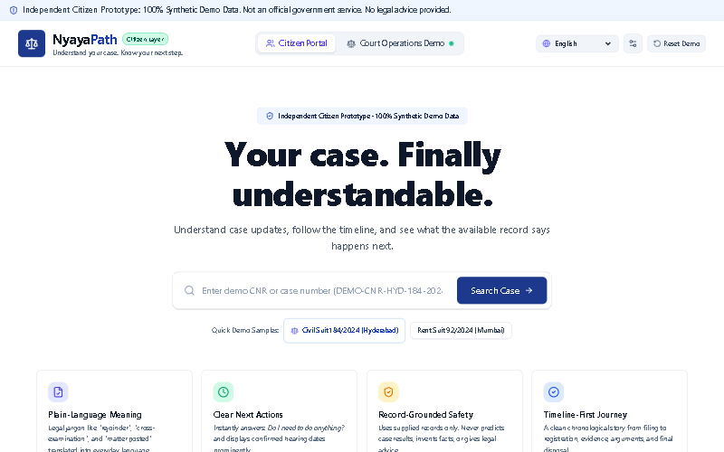
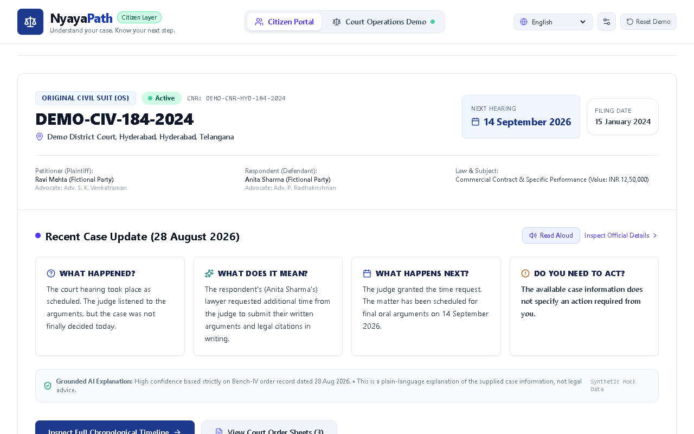
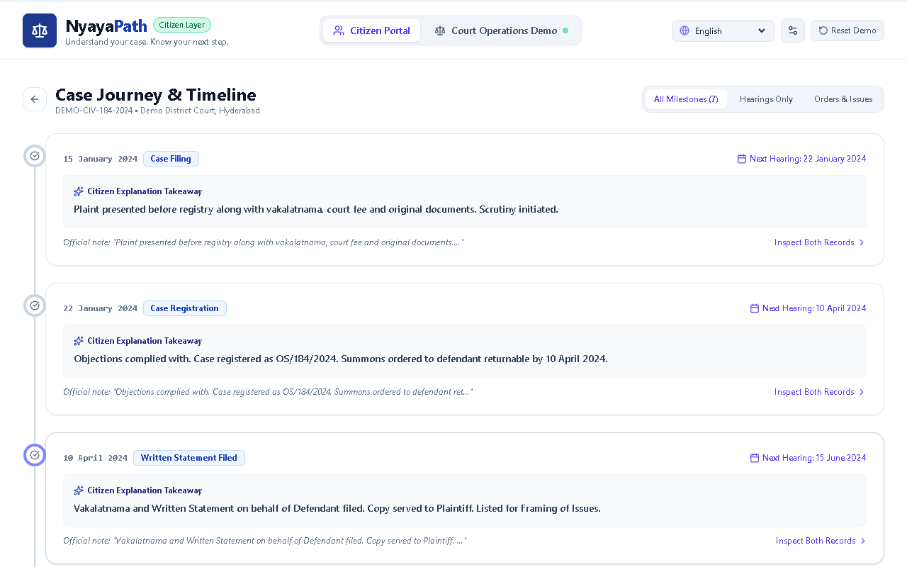
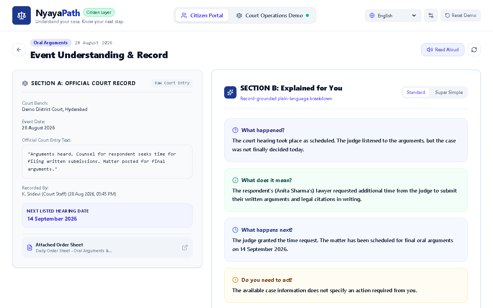
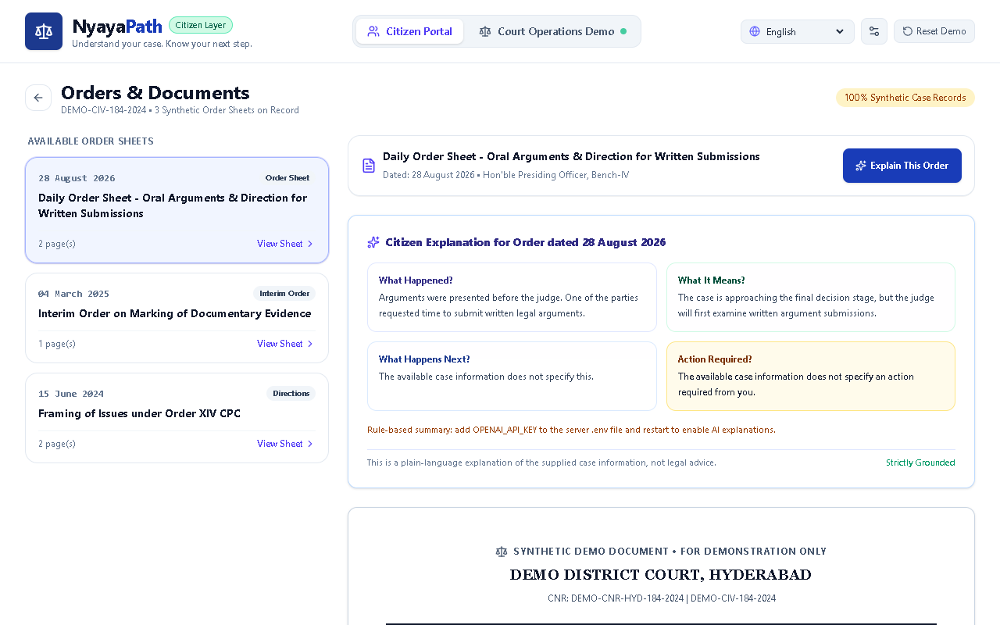
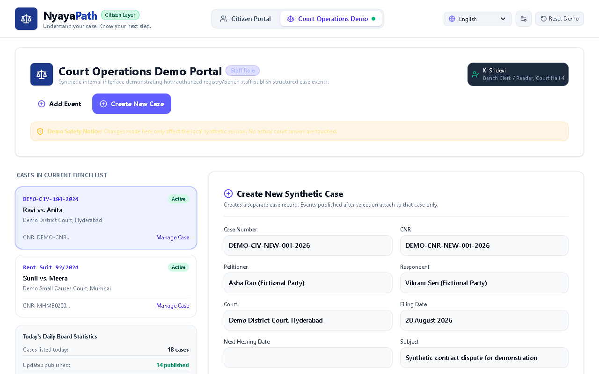
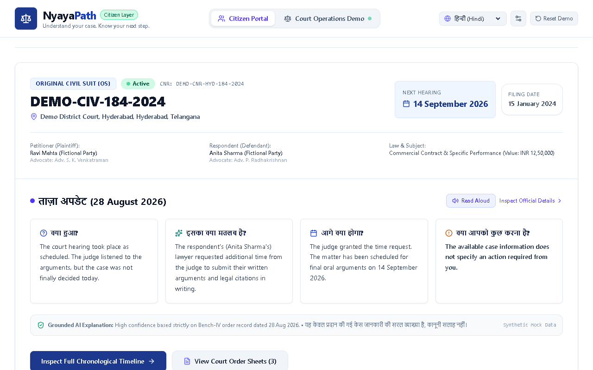
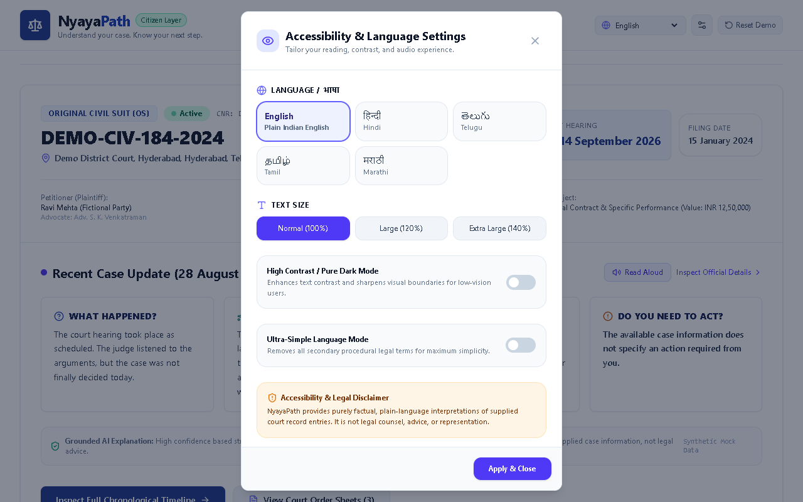
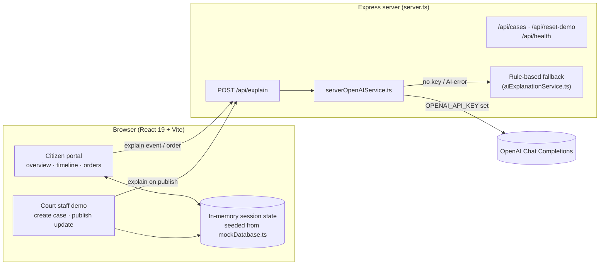

<p align="center"></p>

<p align="center">
  
  
  
  
  
  
  
  
  
</p>

<p align="center">
  
</p>

---

## What it is

Court updates in India are written in dense procedural language: *"Matter posted for final arguments"*, *"PW-1 cross-examined"*, *"reserved for judgment"*. For the people whose case it is, that often means not knowing what happened or whether they need to do anything.

**NyayaPath** ("path to justice") is a citizen-side layer for case updates. It takes a case's official entries and orders and shows them as:

- a **timeline** from filing to the latest hearing,
- four plain answers for each update: **What happened? What does it mean? What happens next? Do I need to act?**,
- the **next hearing date**, shown prominently,
- the **official record shown next to the explanation**, so every sentence can be checked against the source.

Explanations are grounded in the record. The AI prompt forbids inventing facts, predicting outcomes or giving legal advice, and every explanation carries a fixed disclaimer.

> [!IMPORTANT]
> NyayaPath is an independent prototype. **All bundled case data is synthetic.** It is not an official government or eCourts service and **does not provide legal advice**.

<p align="center">
  
</p>

## Features

| | Feature | Details |
|---|---|---|
| 🔎 | **Case search** | Find a case by CNR, case number, party name or court. Unknown queries get a clear "no match" message. |
| 🧭 | **Case overview** | Case type, status, court, parties, advocates, next hearing, and the latest update explained. |
| 🗓️ | **Timeline** | Every update in order, filterable by *All / Hearings / Orders & Issues*, with the next listed hearing at the end. |
| 📖 | **Explained for you** | Official entry (Section A) beside the plain-language breakdown (Section B). **Super Simple** mode cuts it to one sentence plus the action. |
| 📄 | **Order sheets** | Read the synthetic order text and click **Explain This Order** for a breakdown of that specific order. |
| 🤖 | **AI or rule-based** | With `OPENAI_API_KEY` set, explanations come from OpenAI on the server. Without it, the app shows rule-based summaries of the record and a clear "add your API key" notice. |
| 🌐 | **5 languages** | English, हिन्दी, తెలుగు, தமிழ், मराठी for key labels. AI explanations can be requested in the chosen language (needs the API key). |
| 🔊 | **Read aloud** | Uses the browser's speech synthesis with an Indian-locale voice for the selected language. |
| ♿ | **Accessibility** | Text size (100 / 120 / 140 %), high-contrast dark mode, and a simple-language mode. |
| 🏛️ | **Court staff demo** | Create a synthetic case, publish an update from quick templates, and watch it appear in the citizen portal. **Reset Demo** restores the seed data. |

## Screenshots

| Landing | Case overview |
|---|---|
|  |  |
| **Timeline** | **Explained for you** |
|  |  |
| **Order explained** | **Court staff demo** |
|  |  |
| **Hindi labels** | **Accessibility & language** |
|  |  |

## How it works



The API key is read only on the server (`process.env.OPENAI_API_KEY`) and never reaches the browser. In development, Express serves the Vite app as middleware. In production, it serves the built `dist/` folder.

## Quickstart

Requires **Node.js 18+**.

```bash
npm install
```

```bash
cp .env.example .env
```

```bash
npm run dev
```

Open http://localhost:3000 (or the `PORT` you set). Without an API key everything still works and uses rule-based summaries.

Production build:

```bash
npm run build
```

```bash
npm start
```

| Script | What it does |
|---|---|
| `npm run dev` | Express + Vite dev server (`tsx server.ts`) |
| `npm run build` | Builds the client into `dist/` and bundles the server into `dist/server.cjs` |
| `npm start` | Runs the production server from `dist/` |
| `npm run lint` | Type-checks with `tsc --noEmit` |

## Environment variables

| Name | Required? | Default | Where to get it / notes |
|---|---|---|---|
| `OPENAI_API_KEY` | No | none | [platform.openai.com/api-keys](https://platform.openai.com/api-keys). Enables AI explanations, including in other languages. Server-side only. |
| `OPENAI_MODEL` | No | `gpt-4.1-mini` | Any OpenAI chat model that supports JSON output. |
| `PORT` | No | `3000` | Port for the Express server. |
| `APP_URL` | No | none | Listed in `.env.example` for hosted deployments. The current code doesn't read it. |

<details>
<summary><b>Project structure</b></summary>

```text
NyayaPath/
├── server.ts                      # Express API + Vite middleware / static hosting
├── index.html                     # App shell and meta tags
├── src/
│   ├── main.tsx                   # React entry point
│   ├── App.tsx                    # App state, navigation, read-aloud, accessibility
│   ├── types.ts                   # Case, CaseEvent, Order, AIExplanation types
│   ├── index.css                  # Tailwind v4 + dark/high-contrast variant
│   ├── data/
│   │   └── mockDatabase.ts        # Synthetic cases, events, orders, explanations, UI translations
│   ├── lib/
│   │   ├── aiExplanationService.ts    # Prompt, schema, validation, rule-based fallback, client calls
│   │   └── serverOpenAIService.ts     # Server-side OpenAI call with fallback
│   └── components/
│       ├── Header.tsx             # Tabs, language picker, accessibility, reset
│       ├── TrustBanner.tsx        # "Synthetic data, not legal advice" banner
│       ├── ParallaxHero.tsx       # Landing hero, search, demo cases
│       ├── CaseOverviewCard.tsx   # Case summary + four plain answers
│       ├── CaseTimelineView.tsx   # Filterable timeline
│       ├── EventExplanationDetail.tsx  # Official record vs. explanation, Super Simple
│       ├── OrdersDocumentViewer.tsx    # Order sheets + Explain This Order
│       ├── CourtStaffPortal.tsx   # Create case, publish update
│       └── AccessibilityModal.tsx # Language, text size, contrast, simple mode
└── docs/readme/                   # README banner, screenshots, walkthrough
```

</details>

## What's new in this version

| Area | Before | After |
|---|---|---|
| Order sheets | Crashed on any case without orders (the Mumbai demo case and every newly created case). | Shows a clear "no order sheets yet" state. |
| Explain This Order | Returned the **same hardcoded explanation** for every order. | Explains the selected order through `/api/explain`. The paper header shows the case's own court. |
| No API key | Every AI request returned an empty "unavailable" card. | Rule-based summary of the record plus an "add `OPENAI_API_KEY`" notice. |
| AI output | The prompt never named the required JSON keys, and the disclaimer had to match exactly, so valid answers were rejected. | The prompt lists the keys, the disclaimer is set on the server, and language codes are sent as names (Hindi, Tamil…). |
| Event details | Missing explanations fell back to text **copied from one specific case**. | A record-grounded summary, or "the available case information does not specify this." |
| Super Simple / simple-language mode | The toggles did nothing. | They switch to a one-sentence summary plus the action, and the two toggles stay in sync. |
| Text size | Had no visible effect. | Scales the whole UI (100 / 120 / 140 %). |
| High contrast | White cards on a black page. | Cards and text switch to the dark palette (Tailwind v4 dark variant fixed). |
| Search | A query with no match silently opened the demo case. | Says no case matched. |
| Timeline / overview | Hardcoded "(3)" order count, a "Final Oral Arguments… Bench-IV" card on every case, invented text for cases with no updates. | Real counts, a neutral next-hearing card, and honest empty states. |
| Server | Runtime edits changed the seed data, so reset didn't fully restore it. Any amount of client text could be sent to the LLM. | Seed data is deep-copied, and supplied text is capped at 4,000 characters. |

## Future development

- **Persistence:** cases and updates created in the staff portal live in browser memory and disappear on reload. The server already has `/api/cases` endpoints the client could use.
- **Real data source:** integrate with an official case-status source in place of `mockDatabase.ts`.
- **Full localisation:** translate all UI strings (the hero and many labels are still English), and add rule-based summaries in Indian languages.
- **Staff authentication:** the court staff portal is an open demo with no sign-in.
- **Live staff metrics:** the "Today's Daily Board Statistics" panel shows fixed demo numbers.
- **Tests:** add automated tests for the fallback rules and API routes.

## Disclaimer

All names, case numbers, CNRs, orders and parties are fictional. NyayaPath gives a plain-language explanation of the supplied case information, **not legal advice**. For decisions about a real case, consult a qualified advocate or legal-aid service.
